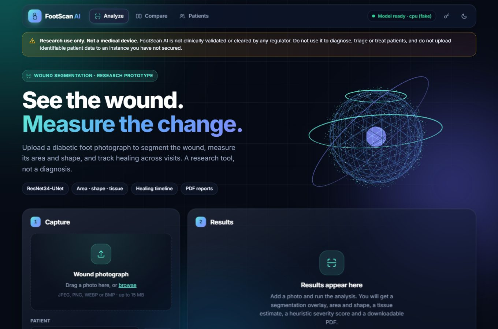
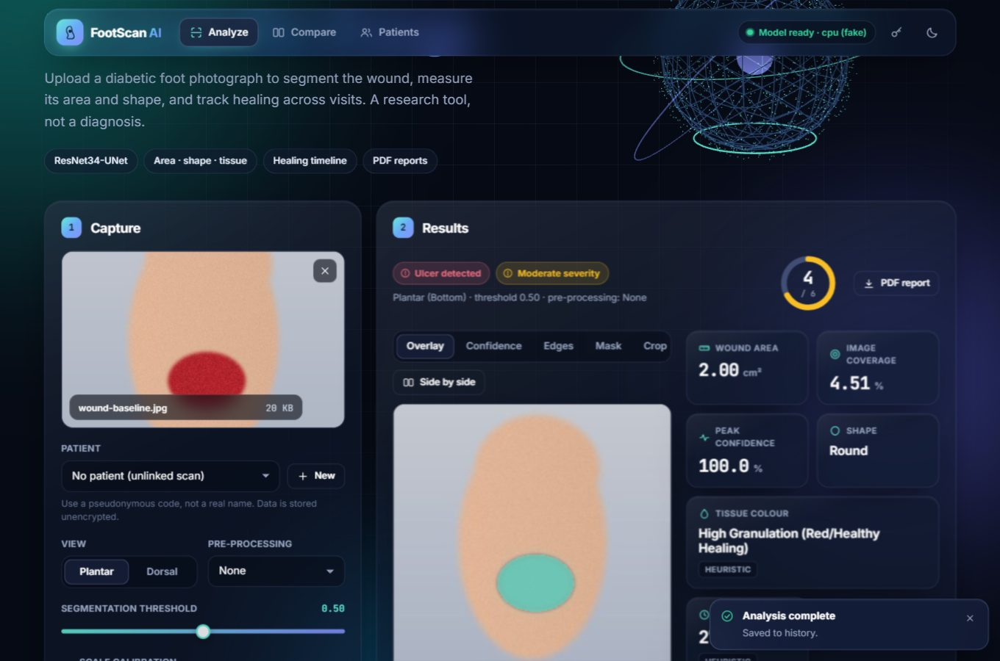
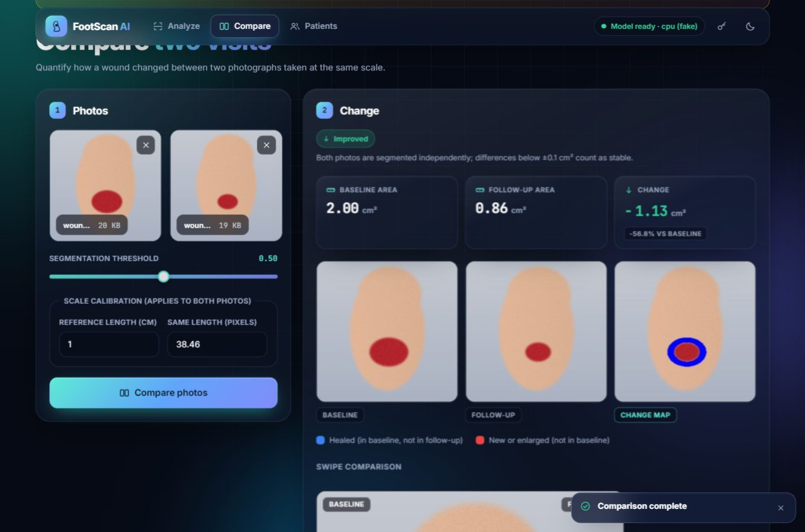
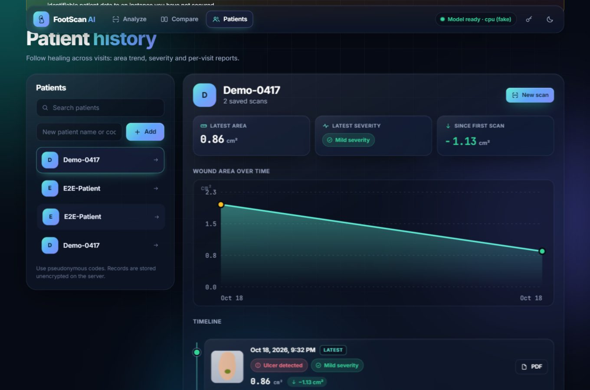

# FootScan AI

[](https://github.com/Sandeepsrinivasan-14/footscan-ai/actions/workflows/ci.yml)


AI-assisted diabetic foot ulcer (DFU) segmentation and triage. Upload a foot photo and get a wound
segmentation mask, area/shape/tissue-colour analysis, a heuristic severity score, and a downloadable
PDF report. Includes before/after comparison and per-patient healing tracking. FastAPI + PyTorch
(ResNet34-UNet) backend and a dependency-free web frontend served by the same process.

> ## Medical disclaimer: research use only
>
> FootScan AI is a **research and demonstration project. It is not a medical device**, has **not
> been clinically validated**, and has not been cleared or approved by the FDA, CE-marking bodies or
> any other regulator. The segmentation model has not been benchmarked on a prospective clinical
> cohort here. The SINBAD-style severity score, healing-time estimate and tissue-colour
> classification are **heuristics from an early prototype**, not a validated clinical guideline.
>
> **Do not use it to diagnose, to triage real patients, or to make treatment decisions.** Always
> defer to a qualified clinician. Do not upload identifiable patient data to any instance you have
> not secured yourself (see [SECURITY.md](SECURITY.md)). Every API analysis response carries a
> `disclaimer` field, and every PDF report carries the same notice.

## Screenshots

| Analyze: upload | Analyze: results |
|---|---|
|  |  |

| Compare | Patients / healing tracker |
|---|---|
|  |  |

Screenshots use placeholder patient names and a publicly sourced wound image.

## Architecture

```
                 +-------------------------------+
 browser ------> | static frontend  (/)          |
                 |                               |
                 +---------------+---------------+
                                 | JSON / multipart
 API clients --> +---------------v---------------+
                 | FastAPI  (footscan.api)       |
                 |  middleware: request id, size |
                 |  guard, headers, access log   |
                 |  deps: API key, rate limit    |
                 |  routes: analysis, patients,  |
                 |          health (/health,/ready)
                 +---------------+---------------+
                                 |
                 +---------------v---------------+
                 | footscan.service              |   orchestrates:
                 +--+----------+----------+------+
                    |          |          |
              ml/model.py  analysis/*   reports/pdf.py
              ResNet34-UNet  shape, colour,  one-page PDF
              (singleton)    SINBAD, healing
                    |
              SQLAlchemy -> SQLite (patients, scans) + data/scans/*.jpg
```

```
backend/footscan/
  config.py          env-driven settings (pydantic-settings, FOOTSCAN_* variables)
  logging_config.py  JSON/text logging with per-request correlation id
  api/               FastAPI app, middleware, deps (auth, rate limit), routes, schemas, upload validation
  ml/                model loading (thread-safe singleton) + preprocessing
  analysis/          pure functions: shape, colour, SINBAD scoring, healing estimate
  reports/           PDF report generation
  db/                SQLAlchemy models + session
  service.py         orchestrates inference, analysis and persistence for the API
frontend/            static HTML/CSS/vanilla-JS SPA (Chart.js from a CDN)
tests/               pytest: unit, API (TestClient, fake model) and integration (real model)
FootScan_AI_Core/    original research prototype, training/eval scripts, weights (Git LFS), WEIGHTS.sha256
```

One process serves the JSON API (`/api/*`, Swagger at `/api/docs`) and the static frontend at `/`. Inference is CPU-bound, so request
handlers run it in a thread pool and the app is meant to run with a single worker per container
(the model is a per-process singleton; scale with replicas).

## Quick start

Prerequisites: Python 3.11, Git LFS. A GPU is optional (a 256x256 ResNet34-UNet runs well under a
second on CPU).

```bash
git clone https://github.com/Sandeepsrinivasan-14/footscan-ai && cd footscan-ai
git lfs pull                                   # fetches the model weights (see "Model weights")

python3.11 -m venv .venv && source .venv/bin/activate        # Windows: .venv\Scripts\activate
pip install torch==2.4.1 torchvision==0.19.1 --index-url https://download.pytorch.org/whl/cpu
pip install -r requirements-dev.txt
cp .env.example .env                           # optional; everything has a default

./scripts/run_dev.sh                           # Windows: .\scripts\run_dev.ps1
```

Then open <http://127.0.0.1:8000/> (app) and <http://127.0.0.1:8000/api/docs> (Swagger).

For a GPU install the `cu121` wheels instead:
`pip install torch==2.4.1 torchvision==0.19.1 --index-url https://download.pytorch.org/whl/cu121`.
torch is installed separately because resolving it together with the other requirements against a
second index makes pip backtrack badly.

## Model weights

Two checkpoints live in `FootScan_AI_Core/` and are tracked with **Git LFS** (see `.gitattributes`):

| File | Size | Used by |
|---|---|---|
| `footscan_best_model.pth` | ~98 MB | the API/UI (ResNet34-UNet, `FOOTSCAN_MODEL_WEIGHTS_PATH`) |
| `footscan_attention_model.pth` | ~150 MB | standalone research scripts only (`train_attention.py`, ...) |

SHA-256 checksums are pinned in [`FootScan_AI_Core/WEIGHTS.sha256`](FootScan_AI_Core/WEIGHTS.sha256).

- **Normal path:** `git lfs install && git lfs pull`.
- **Verify what you have:** `python scripts/download_weights.py --verify-only`.
- **Without LFS** (air-gapped builds, or when the repository's LFS bandwidth quota is exhausted):
  host the file somewhere you control (for example a GitHub Release asset) and run
  `python scripts/download_weights.py --url https://<your-host>/footscan_best_model.pth`
  (or set `FOOTSCAN_WEIGHTS_URL`). Only HTTPS is accepted and the file is installed only if its
  SHA-256 matches.
- **A plain `git clone` without LFS** leaves ~130-byte pointer files. The app detects this: `/ready`
  returns 503 and the log says "is a Git LFS pointer ... run `git lfs pull`".
- Weights are loaded with `torch.load(..., weights_only=True)`, so a tampered checkpoint cannot
  execute code through pickle.
- CI deliberately does not fetch LFS objects on every run (each download counts against the free
  LFS bandwidth quota). Real-model tests run from the manual "integration" workflow dispatch.
- Provenance: the model was trained on the public Foot Ulcer Segmentation Challenge data
  (see `FootScan_AI_Core/README.md`). Confirm the dataset's and the upstream code's licence terms
  before any redistribution beyond research use.

## Configuration

All settings are environment variables prefixed `FOOTSCAN_` (or a git-ignored `.env`); see
[`.env.example`](.env.example) for the full annotated list.

| Variable | Default | Purpose |
|---|---|---|
| `FOOTSCAN_ENVIRONMENT` | `development` | `production` switches to JSON logs, no default CORS origins |
| `FOOTSCAN_API_KEY` | unset | if set, `/api/*` requires a matching `X-API-Key` header. **Set in production.** |
| `FOOTSCAN_CORS_ORIGINS` | localhost (dev) / none (prod) | comma-separated or JSON list of allowed origins |
| `FOOTSCAN_MODEL_WEIGHTS_PATH` | `FootScan_AI_Core/footscan_best_model.pth` | checkpoint to load |
| `FOOTSCAN_DEVICE` | `auto` | `auto`, `cpu` or `cuda` |
| `FOOTSCAN_MAX_UPLOAD_BYTES` | 15 MiB | per-image upload limit |
| `FOOTSCAN_MAX_IMAGE_PIXELS` / `_SIDE` | 40 MP / 12000 px | decompression-bomb guard |
| `FOOTSCAN_RATE_LIMIT_PER_MINUTE` | 30 | per-IP limit on `/api/analyze` and `/api/compare`; 0 disables |
| `FOOTSCAN_LOG_LEVEL` / `FOOTSCAN_LOG_FORMAT` | `INFO` / `auto` | `auto` = JSON in production, text otherwise |
| `FOOTSCAN_DATA_DIR` / `FOOTSCAN_DATABASE_URL` | `./data`, SQLite inside it | scan images, reports, DB |

## API

Interactive docs: `/api/docs` (OpenAPI JSON at `/api/openapi.json`). `X-API-Key` is required on
`/api/*` only when `FOOTSCAN_API_KEY` is set; `/health` and `/ready` are always open.

| Method | Path | Purpose |
|---|---|---|
| GET | `/health` | Liveness. Always 200 while the process is up; `status` is `degraded` if the model is not loaded |
| GET | `/ready` | Readiness. 200 only if the database is reachable **and** the model is loaded, else 503 |
| POST | `/api/analyze` | Multipart image upload -> segmentation, metrics, 6 inline visualisations; optionally saved |
| POST | `/api/compare` | Two images (`old_image`, `new_image`) -> area change and diff map |
| GET | `/api/scans/{id}/image/{original\|overlay}` | Stored scan image |
| GET | `/api/scans/{id}/report` | One-page PDF report for a saved scan |
| POST | `/api/patients` | Create a patient (`{"name": "..."}`) |
| GET | `/api/patients?limit=&offset=` | List patients (limit 1-1000, default 200) |
| GET | `/api/patients/{id}` / `/api/patients/{id}/scans` | A patient / their scan history |

`POST /api/analyze` form fields:

| Field | Type | Default | Validation |
|---|---|---|---|
| `image` | file | required | JPEG/PNG/WEBP/BMP detected from the bytes (not `Content-Type`), within the size/pixel limits |
| `ref_cm` | float | 1.0 | `0 < x <= 1000`, length of the reference marker in cm |
| `ref_px` | float | 38.46 | `0 < x <= 100000`, the marker's length in pixels |
| `threshold` | float | 0.5 | `0 <= x <= 1` |
| `prep_method` | enum | `None` | `None`, `CLAHE`, `Histogram Equalization` |
| `view_type` | enum | `Plantar (Bottom)` | `Plantar (Bottom)`, `Dorsal (Top)` |
| `patient_id` | string | none | must reference an existing patient (404 otherwise) |
| `save` | bool | true | persist the scan and images |

```bash
curl -X POST http://127.0.0.1:8000/api/analyze \
  -H "X-API-Key: $FOOTSCAN_API_KEY" \
  -F image=@foot.jpg -F threshold=0.5 -F prep_method=CLAHE
```

Errors are JSON `{"detail": ...}`: `400` undecodable image, `401` bad/missing key, `404` unknown
resource, `413` too large (bytes, pixels or request body), `415` image format not allowed, `422`
invalid parameters (the response never echoes your input back), `429` rate limited (with
`Retry-After`), `503` model unavailable, `500` unexpected (generic message plus a `request_id`).
Every response carries an `X-Request-ID` (send your own to correlate; invalid values are replaced),
and `/api/*` responses are `Cache-Control: no-store`.

## Docker

```bash
git lfs pull                                    # the default image bakes in footscan_best_model.pth
export FOOTSCAN_API_KEY="$(python -c 'import secrets; print(secrets.token_urlsafe(32))')"
docker compose up --build                       # http://127.0.0.1:8000
```

- Multi-stage build on `python:3.11-slim`, CPU torch by default. Runs as non-root uid 10001, has a
  `HEALTHCHECK` on `/ready`, a read-only root filesystem and dropped capabilities under compose, and a
  named volume for `/app/data`.
- The build **fails** if the weights are still an LFS pointer, instead of producing a broken image.
- `docker build --target runtime .` builds the same image **without** weights; mount them at run
  time (`-v ./FootScan_AI_Core:/app/FootScan_AI_Core:ro`).
- GPU: `docker compose -f docker-compose.yml -f docker-compose.gpu.yml up --build` (NVIDIA Container Toolkit).
- The port is published on `127.0.0.1` only. Put a TLS-terminating reverse proxy in front for anything else.

### Deployment notes

- Set `FOOTSCAN_API_KEY` and `FOOTSCAN_CORS_ORIGINS`; the app logs a warning at startup in
  production if no key is set.
- The built-in rate limiter is in-process and per client IP. Behind a proxy, set
  `FORWARDED_ALLOW_IPS` so uvicorn trusts `X-Forwarded-For` (the image runs with `--proxy-headers`), and
  prefer enforcing request-size and rate limits at the proxy/gateway for multi-replica deployments.
- Scan images and the SQLite DB are stored unencrypted under `FOOTSCAN_DATA_DIR`; use an encrypted volume.

## Development and testing

```bash
ruff check backend tests scripts
pytest -m "not integration"      # unit + API tests with a fake model; no weights needed (this is what CI runs)
pytest -m integration            # real model; needs the weights
pytest                           # everything; integration tests skip themselves if weights are absent
```

CI (`.github/workflows/ci.yml`) runs lint, the unit/API tests, and a Docker build + smoke test
(non-root user, `/health` 200, `/ready` 503 without weights) on every PR. The real-model integration
job is manual (`workflow_dispatch`). Dependabot tracks pip, GitHub Actions and Docker updates.
See [CONTRIBUTING.md](CONTRIBUTING.md).

## Known limitations

- **Clinical validity**: see the disclaimer. The scoring heuristics need a real clinical source.
- **Model accuracy** has not been independently benchmarked in this repository
  (`FootScan_AI_Core/evaluate.py` computes Dice/IoU on the challenge test split).
- **Security scope**: one shared API key, no user accounts, roles, audit log or encryption at rest.
  Not suitable for multi-tenant or regulated (HIPAA/GDPR-grade) use. See [SECURITY.md](SECURITY.md).
- **Rate limiting** is per-process and in-memory.

## Acknowledgements

`FootScan_AI_Core/` builds on the wound-segmentation research of Wang et al., *Fully Automatic Wound
Segmentation with Deep Convolutional Neural Networks*, Scientific Reports 10:21897 (2020), and the
Foot Ulcer Segmentation Challenge dataset from the AZH Wound and Vascular Center. See
`FootScan_AI_Core/README.md` for details and credits.

## License

MIT, see [LICENSE](LICENSE). The licence covers this repository's code; datasets and third-party
components keep their own terms.
